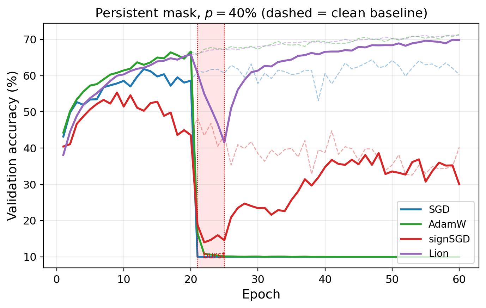
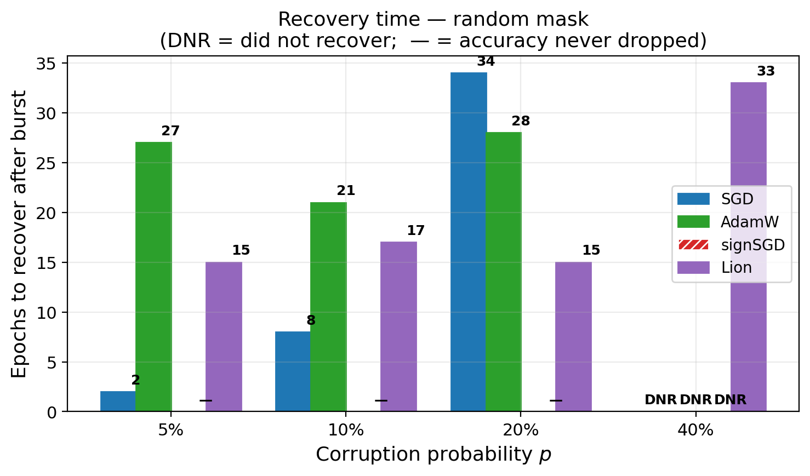
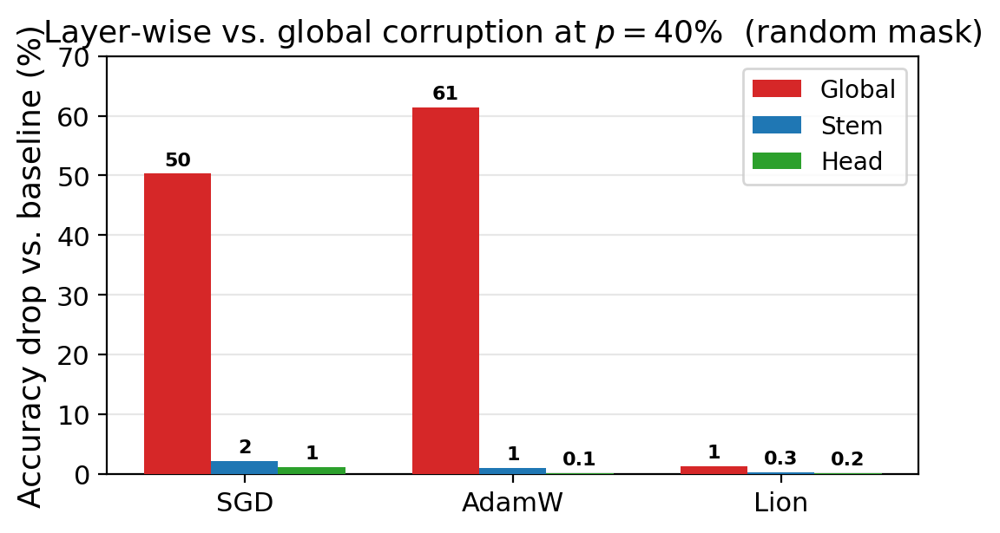

# Optimizer Robustness Under Temporary Gradient Sign Corruption

**EPFL · CS-439 Optimization for Machine Learning · Spring 2026**  
**Python · PyTorch · CIFAR-10 · SGD · AdamW · signSGD · Lion**

> How do common optimizers recover when training gradients are temporarily corrupted?

This academic research project compares four optimizers — **SGD with momentum, AdamW, signSGD, and Lion** — on CIFAR-10 image classification. We deliberately reverse the signs of a fraction of gradient coordinates during a **five-epoch burst (epochs 20–25)** and measure the subsequent change in accuracy and recovery time. Experiments investigate both independently resampled and persistent corruption masks, as well as corruption restricted to individual network layers.

**Key finding:** under **40% global gradient sign corruption**, Lion returned to **69.8%** validation accuracy, just **1.3 percentage points** below its clean baseline (**71.1%**). SGD and AdamW both fell to approximately **10%** (chance-level) accuracy and did not recover within the evaluated training horizon. These figures describe the experiments in our course report, not a general guarantee of robustness.

## Results at a glance

Final validation accuracy after 60 epochs, **random-mask** corruption across all layers (from the project report):

| Optimizer | Clean baseline | 5% corruption | 10% corruption | 20% corruption | 40% corruption |
|---|---:|---:|---:|---:|---:|
| SGD (momentum) | 60.3% | 64.0% | 63.2% | 59.8% | **10.0%** |
| AdamW | 71.4% | 70.0% | 70.4% | 70.6% | **10.0%** |
| signSGD | 40.2% | 31.0% | 32.4% | 34.1% | 30.0% |
| **Lion** | **71.1%** | **71.4%** | **71.2%** | **71.2%** | **69.8%** |

At **40%** corruption, signSGD remained above chance but did not meet the recovery criterion. Lion was the only method to recover in both random- and persistent-mask experiments. The report defines recovery as reaching at least 98% of the corresponding clean final accuracy after the corruption ends.

### Effect of a persistent 40% corruption burst



The shaded region marks the corruption burst. Dashed lines show each optimizer's clean reference trajectory.

### Recovery speed under random corruption



### Corrupting one layer versus the entire model



At 40% corruption, perturbing only the stem or classifier head was much less damaging than perturbing all layers simultaneously, suggesting that unaffected layers can help stabilize training.

## Experimental design

- **Task:** CIFAR-10 classification with a small convolutional neural network.
- **Training:** 60 epochs, batch size 128, fixed seed 42; a clean baseline is trained for each optimizer.
- **Attack:** after backpropagation, signs of a fraction of gradient coordinates are flipped for five epochs.
- **Corruption rates:** 5%, 10%, 20%, and 40%.
- **Mask strategies:** **random** (new coordinates every step) and **persistent** (fixed coordinates throughout the burst).
- **Layer targets:** global, input stem, and classifier head.
- **Evaluation:** final validation accuracy, accuracy degradation, and number of epochs needed to recover.

The results highlight the role of **optimizer state and momentum smoothing** under transient gradient perturbations. These experiments use a small CNN and a single image-classification benchmark; wider applicability would require further testing.

## Repository contents

```text
optimizer-robustness-gradient-corruption/
├── models/                    # CNN architectures
├── results/                   # Saved experimental CSVs
├── figures/paper/             # Selected plots used in the report
├── docs/project-report.pdf    # Full team report
├── run.py                     # Regenerate figures from saved results
├── run_experiments.py         # Global experiment runner
├── run_experiments_bis.py     # Layer-wise experiment runner
├── train.py, train_bis.py     # Training and metric logging
├── corruption.py             # Gradient sign corruption implementations
├── optimizers.py             # signSGD and Lion implementations
├── data_loader.py            # CIFAR-10 loading / preprocessing
├── generate_paper_figures.py # Figure generation
├── Notebook.ipynb            # Exploration notebook (outputs cleared)
└── requirements.txt
```

## Quick start

**Prerequisites:** Python 3 and a compatible installation of PyTorch / torchvision. These dependencies are not version-pinned, and the complete training suite has not been revalidated in a new environment.

```bash
git clone https://github.com/kamilchaoui/optimizer-robustness-gradient-corruption.git
cd optimizer-robustness-gradient-corruption
python -m pip install -r requirements.txt
```

### Reproduce the paper plots (no training required)

The final experiment CSVs are included, so the key figures can be regenerated immediately:

```bash
python run.py
```

Outputs are written to `figures/paper/`. This operation uses the saved data and **does not rerun training**.

### Small training smoke test

CIFAR-10 will be downloaded into the locally ignored `data/` directory at first use:

```bash
python run_experiments.py --epochs 5 --subset 2000 --optimizers sgd adamw --p_values 0.0 0.2 --output results/smoke_test.csv
```

This is a code-path check, **not** a replication of the 60-epoch research results. To reproduce specific full runs, see the commands in `run_experiments_bis.py` and the original experiment configuration. Running the full experiment suite requires substantially more compute.

**Reproducibility note:** `run.py --full` reruns a **subset** of the archived experiments, not the entire set of team-generated experiments; some head-layer CSVs originated from a collaborator's implementation. The included report and archived CSVs provide the authoritative results. We have preserved the experiment scripts rather than claiming an independently verified end-to-end replication.

## Authors & acknowledgements

**Joanne Jegou · Kamil Chaoui El Faiz · Thybault Lorthiois**  
Team project for **CS-439 Optimization for Machine Learning, EPFL (Spring 2026)**.

The repository represents collaborative academic work; no exclusive attribution for individual code components is asserted here. Refer to the [full report](docs/project-report.pdf) for experimental methodology, limitations, and references.

**Data:** [CIFAR-10](https://www.cs.toronto.edu/~kriz/cifar.html). Third-party research PDFs and datasets are not redistributed in this repository.
